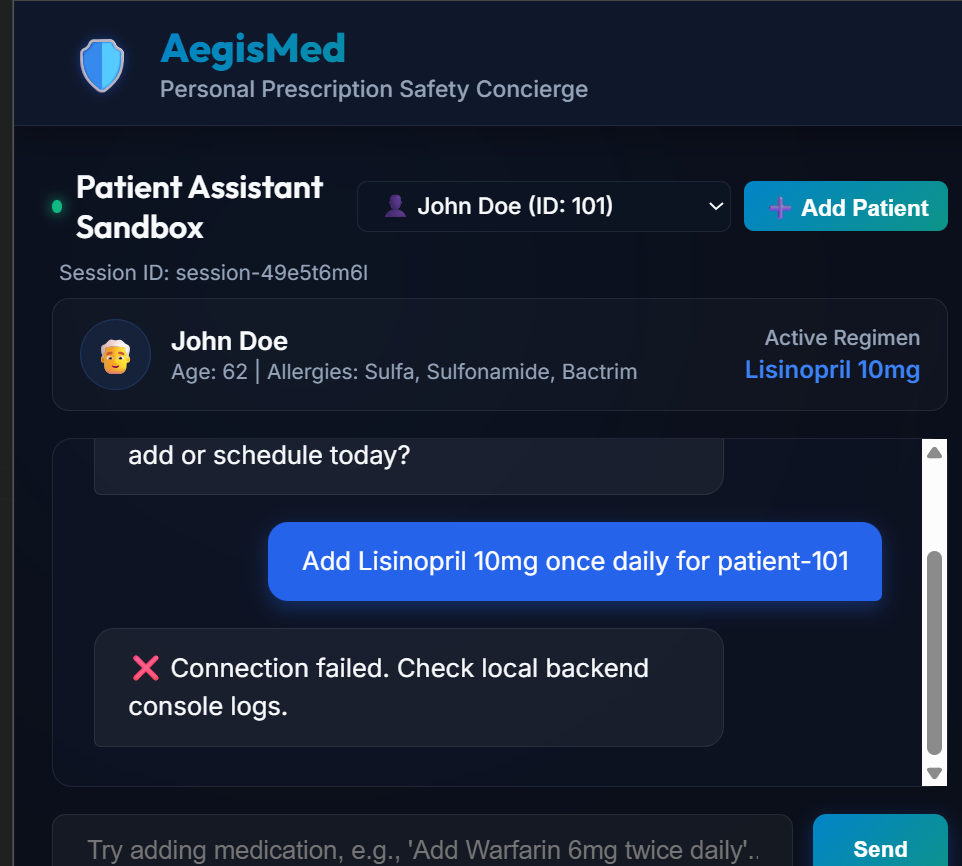
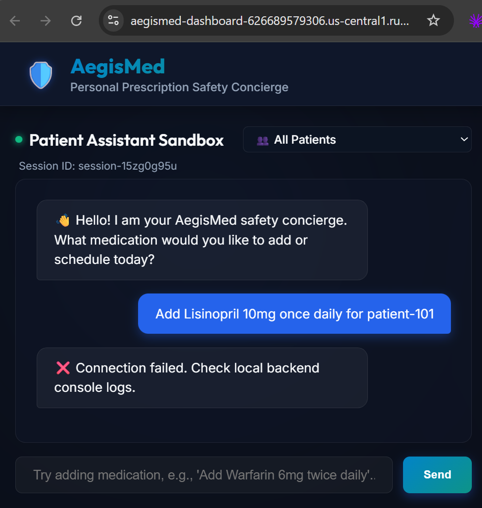
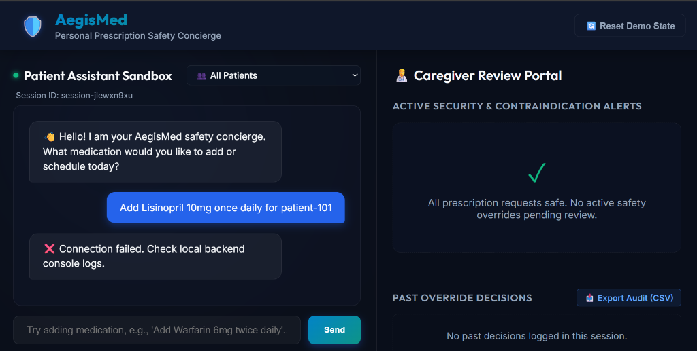
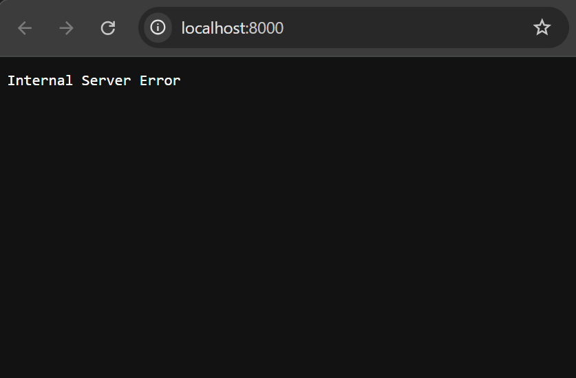

# AegisMed Personal Safety Concierge

AegisMed is a state-of-the-art personal safety concierge and clinical safety firewall designed to prevent medication errors, protect patient PII, and facilitate seamless caregiver override triage. Built using the Google ADK (Agent Development Kit) 2.0 Graph Workflow framework, FastMCP, and a beautiful responsive glassmorphic caregiver dashboard.

---

## 📸 Workflow & UI Mockups

Here are the system design and caregiver portal dashboard mockups illustrating the clinical safety concierge workflow:

### Caregiver Portal & Live Dashboard
Below is the glassmorphic dark-themed Caregiver Dashboard, featuring dynamic patient profiles, active regimen switcher, live safety chat, pending contraindication alerts, and audit log exports:



### Clinical Decision Support Workflows
These mockups highlight the clinical evaluation check, safety alerts, and human-in-the-loop override triage workflows:







---

## 🛠️ About The Project

AegisMed acts as an intelligent safety layer between patient prescription requests and execution. It comprises:
1. **Pre-commit Secrets Scan**: A Semgrep scanner hook that blocks commits containing hardcoded Gemini API keys.
2. **FastMCP Clinical Safety Server**: A Model Context Protocol server that implements drug-to-drug safety rules, dosage limits (e.g. blocking daily Warfarin doses > 10mg), and patient-specific **Allergy Conflict Checks** (e.g. penicillin, sulfa, aspirin).
3. **ADK 2.0 Graph Workflow Agent**: A stateful routing graph that scrubs PII (SSNs and phone numbers), detects prompt injections, reviews secondary clinical risks, handles model tool calls, and pauses/resumes execution using caregiver-in-the-loop triage.
4. **Caregiver Dashboard**: A FastAPI-based glassmorphic dark-themed caregiver portal using Outfit/Inter typography, responsive layouts, and hardware-accelerated drifting background orbs.

---

## 🚀 Key Features

* **Dynamic Patient Registration**: Register new patients directly from the dashboard. This dynamically updates the persistent `patients.json` database, syncs client-side profiles, and instantly registers active allergy rules with the MCP server in real-time.
* **Patient Profile Switcher Banner**: Select specific patients dynamically to display their name, age, allergen list, and active regimens in the chat header, while auto-filtering sandbox messages and caregiver alerts.
* **Allergy Checker MCP Integration**: Exposes the `check_allergy_conflict` tool. If an allergic patient is prescribed a conflicting drug, the workflow automatically intercepts the request, blocks auto-approval, and alerts the caregiver.
* **Triage & Override Cards**: Slide-out alert cards that collapse vertically when approved/rejected, and sandbox messages that scale-bounce and glow amber when located.
* **Clinical CSV Auditor**: One-click download compiles caregiver override logs into a structured CSV for auditing compliance.
* **Security & Containment**:
  * **PII Scrubbing**: Sanitizer regexes replace Social Security Numbers and Phone numbers with `[REDACTED_SSN]` and `[REDACTED_PHONE]` respectively in the state metadata before external LLM calls.
  * **Prompt Injection Prevention**: Graph routes injection keywords (e.g. `Ignore previous instructions`) to a bypass node that skips direct LLMs and goes straight to clinical validation, keeping the system safe.

---

## 💻 Local Setup & Development

### 1. Prerequisites
Ensure you have Python 3.10+ and Git installed.

### 2. Install Dependencies
Clone the repository and install the required Python packages:
```bash
python -m venv .venv
.\.venv\Scripts\activate
pip install -r aegismed-agent/pyproject.toml
pip install fastapi uvicorn jinja2 python-multipart google-genai google-auth
```

### 3. Running the App locally
To start the FastAPI web dashboard server locally:
```powershell
$env:GOOGLE_CLOUD_PROJECT="YOUR_PROJECT_ID"
$env:GOOGLE_CLOUD_LOCATION="us-central1"
$env:GOOGLE_GENAI_USE_VERTEXAI="True"
python dashboard/main.py
```
Access the local dashboard at `http://127.0.0.1:8000`.

---

## ☁️ Google Cloud Deployment

The application is fully containerized and configured for deployment to **Google Cloud Run** running on **Vertex AI**:

### Deploy Command
```powershell
gcloud run deploy aegismed-dashboard `
  --source . `
  --project YOUR_PROJECT_ID `
  --region us-central1 `
  --allow-unauthenticated `
  --set-env-vars "GOOGLE_CLOUD_PROJECT=YOUR_PROJECT_ID,GCP_PROJECT=YOUR_PROJECT_ID,GOOGLE_CLOUD_LOCATION=us-central1,GOOGLE_GENAI_USE_VERTEXAI=True"
```
