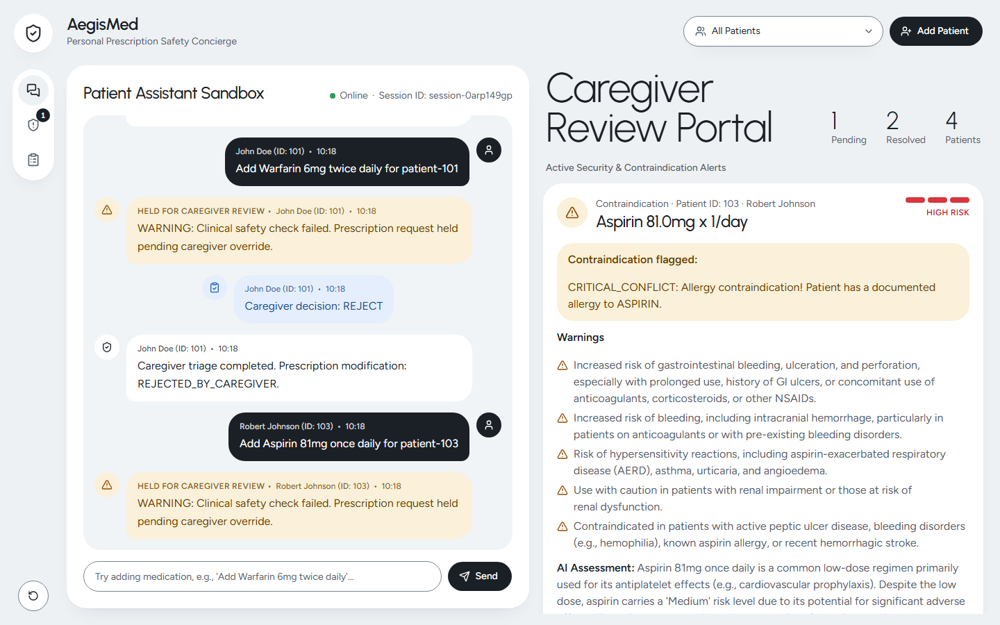
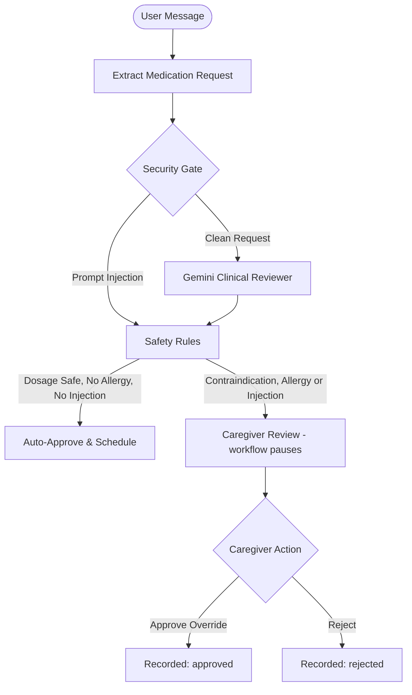

# AegisMed Personal Safety Concierge

AegisMed is a personal safety concierge and clinical safety firewall. It stops medication errors, protects patient PII, and routes risky prescription requests to a caregiver for approval. It is built with the Google ADK 2.x graph workflow, FastMCP, FastAPI, and a Next.js caregiver dashboard.



---

## How it works



* **Security gate.** SSNs and phone numbers are replaced with `[REDACTED_SSN]` and `[REDACTED_PHONE]` before anything is stored or sent to the model. Requests containing prompt-injection phrases skip the model and are held for caregiver review with a High risk and a security warning.
* **Gemini reviewer.** Adds general warnings and an explanation to the alert. It never decides on its own: the outcome comes from the deterministic rules.
* **Safety rules** (`aegismed-agent/app/safety_rules.py`). One implementation, shared by the workflow and the MCP server: a daily Warfarin limit of 10 mg and an allergy check by drug name against the patient's documented allergies. Brand names and drug classes that are not listed for a patient are not recognised.
* **Pause and resume.** A held request pauses the ADK workflow. The paused session is stored as JSON, so any server instance can resume it when the caregiver decides.

### Dashboard

* Patient chat sandbox with a patient switcher, profile banner and Add Patient form.
* Alert cards with Approve Override, Reject Request and Locate in Sandbox.
* Past Override Decisions table and CSV audit export.
* Reset Demo State clears chat history and alerts; registered patients stay.
* Accessibility: WCAG AA contrast, 44px targets, visible focus, keyboard operation, status shown by icon and text as well as colour, reduced-motion support.

---

## Repository layout

```
vercel.json              Vercel Services: web (Next.js) + api (FastAPI), one origin
web/                     Next.js 16 dashboard (TypeScript, Tailwind 4, shadcn/ui)
aegismed-agent/
  pyproject.toml         The single Python dependency manifest
  app/                   ADK workflow, safety rules, extraction, security, storage
  dashboard_api/         FastAPI app and the ADK session service
  server.py              FastMCP server exposing the safety rules
  tests/                 pytest suite (tests/eval holds the ADK eval sets)
Dockerfile               Builds the UI and API into one container image
```

---

## Environment variables

Set these as environment variables only. Never commit them.

| Name | Needed | Purpose |
|---|---|---|
| `GOOGLE_API_KEY` (or `GEMINI_API_KEY`) | Gemini API-key mode | Authenticates the Gemini reviewer |
| `GOOGLE_GENAI_USE_VERTEXAI`, `GOOGLE_CLOUD_PROJECT`, `GOOGLE_CLOUD_LOCATION` | Vertex AI mode instead of an API key | Uses Application Default Credentials |
| `GEMINI_MODEL` | Optional | Model name, default `gemini-2.5-flash` |
| `UPSTASH_REDIS_REST_URL` and `UPSTASH_REDIS_REST_TOKEN` (or `KV_REST_API_URL` and `KV_REST_API_TOKEN`) | Production | Durable store. Without these, local runs use JSON files; on Vercel the API answers 503 |
| `AEGISMED_DATA_DIR` | Optional, local | Folder for the JSON-file store (default `aegismed-agent/.data`) |
| `AEGISMED_KEY_PREFIX` | Optional | Redis key namespace (default `aegismed:<VERCEL_ENV>`) |

Notes on Gemini: Google plans to retire `gemini-2.5-flash` on 1 December 2026, so check its current model list and set `GEMINI_MODEL` accordingly. On the free tier Google may use prompts to improve its products, so keep the demo to fictional patients.

---

## Run locally

Requirements: Python 3.12 or 3.13, Node.js 22 or newer.

```bash
# API (from the repository root)
python -m venv .venv
.venv\Scripts\activate            # macOS/Linux: source .venv/bin/activate
pip install -e "aegismed-agent[dev]"
cd aegismed-agent
set GOOGLE_API_KEY=your-key       # PowerShell: $env:GOOGLE_API_KEY="your-key"
python -m dashboard_api.main      # serves http://127.0.0.1:8000
```

```bash
# UI, in a second terminal
cd web
npm install
set API_PROXY_TARGET=http://127.0.0.1:8000    # PowerShell: $env:API_PROXY_TARGET="http://127.0.0.1:8000"
npm run dev                                    # http://localhost:3000
```

Tests and checks:

```bash
cd aegismed-agent && python -m pytest        # backend; Gemini is stubbed, no key needed
cd web && npm run typecheck && npm run lint && npm run build
```

To run the FastMCP server as well: `pip install -e "aegismed-agent[mcp]"`, then `python server.py` from `aegismed-agent`.

---

## Deploy to Vercel

The project uses [Vercel Services](https://vercel.com/docs/services) (beta): `vercel.json` declares the `web` and `api` services, and routes `/api/*` to the API and everything else to the UI.

1. Install the CLI (`npm i -g vercel`) and sign in with `vercel login`.
2. Create and link the project: `vercel project create aegismed-dashboard`, then `vercel link --project aegismed-dashboard`.
3. Add a durable store. `vercel integration add upstash/upstash-kv --name aegismed-kv --billing-plan free --no-env-pull` creates a free Upstash Redis database and connects it. The first time, accept Upstash's terms in the browser when the CLI asks.
4. Store your Gemini key as a secret. It is read from the environment, never from a file:
   ```bash
   vercel env add GOOGLE_API_KEY --environment production,preview --sensitive
   ```
5. Deploy a preview with `vercel deploy --target=preview`, then production with `vercel deploy --prod`.

Previews sit behind Vercel's Deployment Protection. Use `vercel curl <url>` to call them from a terminal.

---

## Deploy as a container (Cloud Run)

The root `Dockerfile` builds the UI as static files and serves them from the FastAPI image, so one container serves both on one origin.

```bash
docker build -t aegismed .
docker run -p 8080:8080 -e GOOGLE_API_KEY=your-key aegismed
```

For Cloud Run, pass the variables above as separate `--set-env-vars` entries. Without Redis credentials the container keeps state in local files, which Cloud Run does not preserve between instances.

---

## Security notes

* `POST /api/chat` and the other endpoints are public and unauthenticated. Anyone with the URL can submit requests, spend your Gemini quota, and resolve alerts. Put the deployment behind Vercel authentication or add your own before using it with real data.
* This is a demonstration of a safety workflow, not a certified clinical system. Its rules are small and name-based by design.
* Keep API keys in the platform's environment-variable store. `.env*` files are ignored by git and by the Vercel upload.
